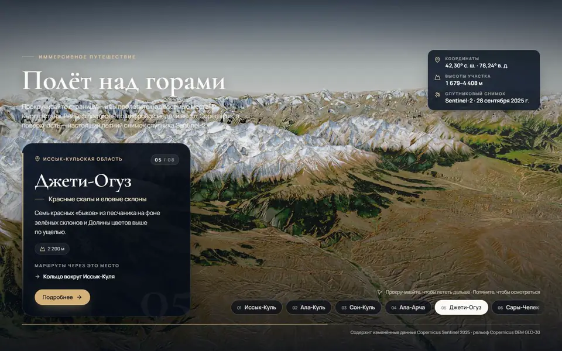
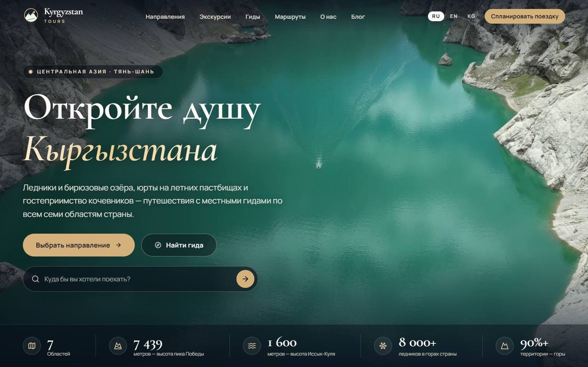
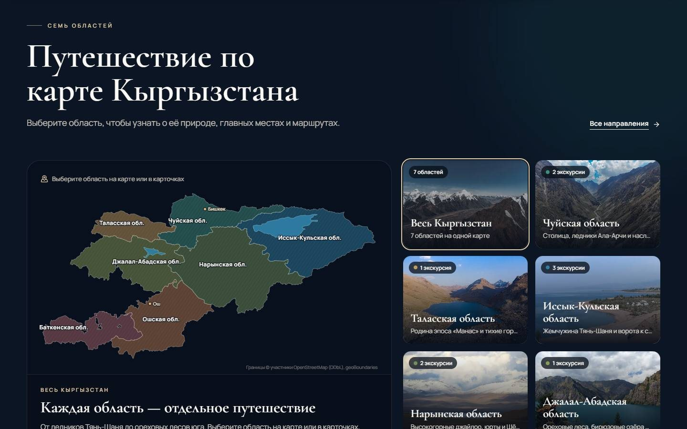
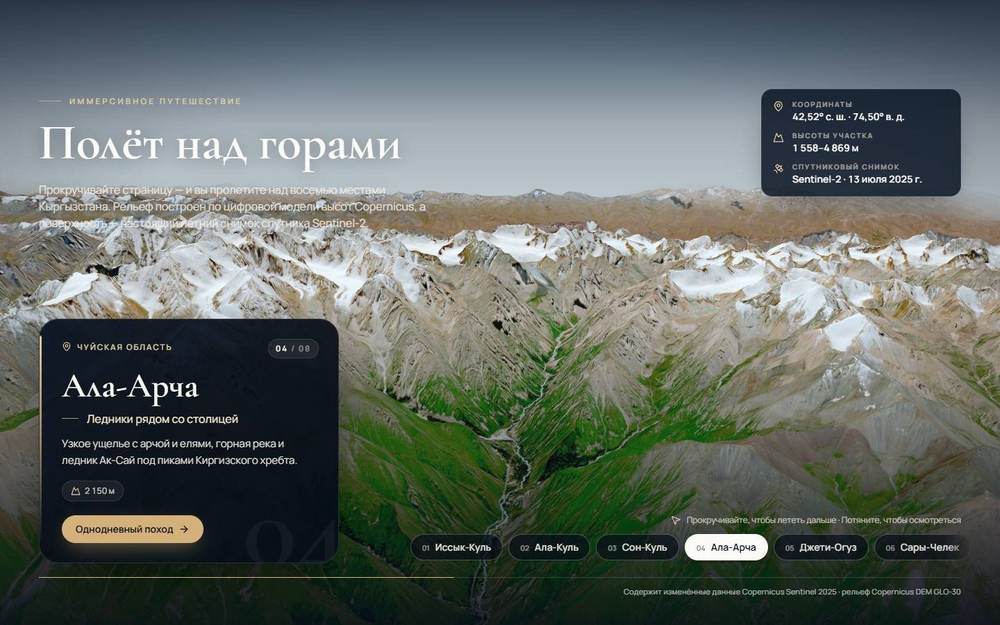
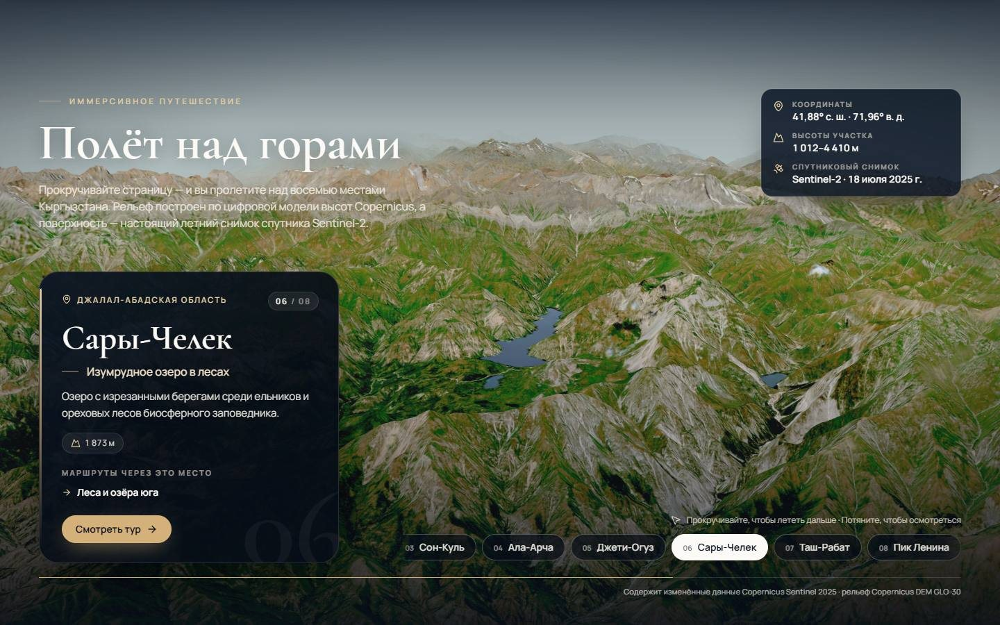
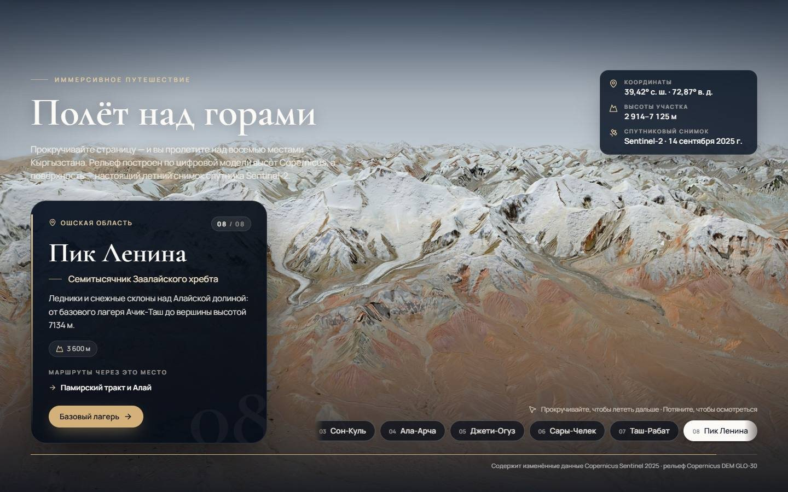
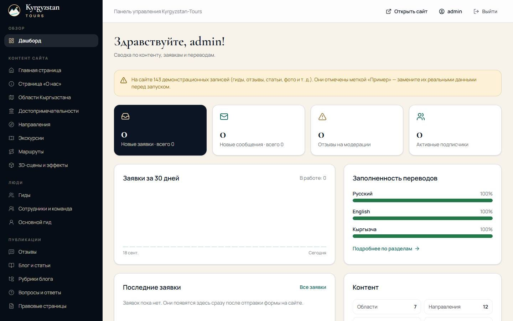
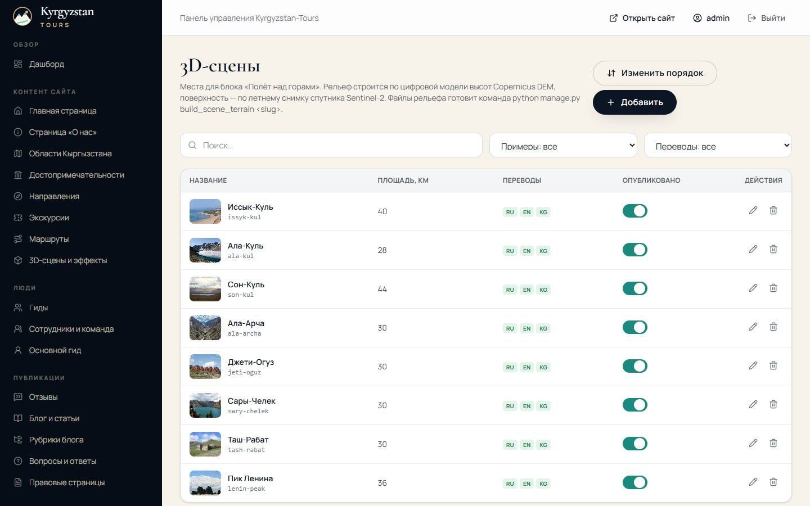
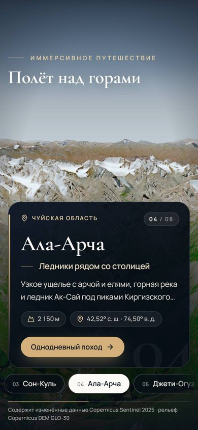
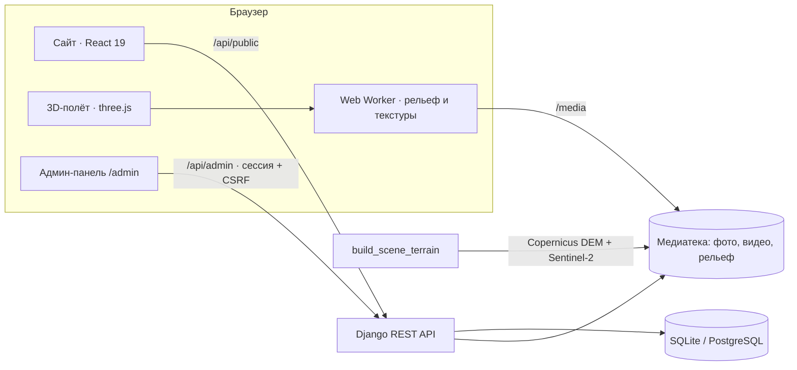

<div align="center">


<h3>Премиальный туристический сайт о Кыргызстане</h3>

<p>Реальный 3D-полёт над горами · интерактивная карта семи областей · экскурсии и местные гиды · собственная админ-панель · три языка</p>

<p>
  <a href="https://github.com/AtaiDev/Kyrgyzstan-Tours/actions/workflows/ci.yml"></a>
  
  
  
  
  
  
</p>

<p>
  <a href="https://render.com/deploy?repo=https://github.com/AtaiDev/Kyrgyzstan-Tours"></a>
</p>

</div>

<p align="center">
  
</p>

<p align="center"><sub>Настоящий рельеф Copernicus DEM и летние снимки спутника Sentinel-2: при прокрутке камера пролетает сквозь облака от Джети-Огуза к озеру Сары-Челек.</sub></p>

## ✨ Главное

<table>
  <tr>
    <td width="33%" valign="top"><h4>🏔️ Реальный 3D-полёт</h4>Восемь мест — от Иссык-Куля до пика Ленина — построены по цифровой модели высот и спутниковым снимкам. У каждого места своя траектория камеры, на горизонте — настоящие хребты.</td>
    <td width="33%" valign="top"><h4>🗺️ Карта Кыргызстана</h4>Интерактивная карта всех семи областей с подсказками, карточками направлений и подборками мест.</td>
    <td width="33%" valign="top"><h4>🎬 4K-видео на первом экране</h4>Бесшовный 20-секундный цикл гор Тянь-Шаня и озера Кель-Суу. На телефонах и медленных сетях загружается облегчённая версия 1080p.</td>
  </tr>
  <tr>
    <td valign="top"><h4>🧭 Экскурсии и маршруты</h4>Программы по дням, карта маршрута, остановки, сезоны, фильтры и форма бронирования.</td>
    <td valign="top"><h4>🛠️ Своя админ-панель</h4>Весь контент — тексты, фото, видео, 3D-сцены, SEO, заявки, роли и права — редактируется без правки кода.</td>
    <td valign="top"><h4>🌍 Три языка</h4>Русский, английский и кыргызский: переводы контента, интерфейса, SEO и адресов страниц.</td>
  </tr>
</table>

## 🖼️ Галерея

<table>
  <tr>
    <td width="50%"><br><sub><b>Первый экран</b> — 4K-видео гор и озера Кель-Суу</sub></td>
    <td width="50%"><br><sub><b>Карта Кыргызстана</b> — семь областей и подборки мест</sub></td>
  </tr>
  <tr>
    <td><br><sub><b>Ала-Арча</b> — пролёт вдоль ущелья к ледникам</sub></td>
    <td><br><sub><b>Переход сквозь облака</b> — название следующего места</sub></td>
  </tr>
  <tr>
    <td><br><sub><b>Сары-Челек</b> — озеро среди ореховых лесов</sub></td>
    <td><br><sub><b>Пик Ленина</b> — 7134 м над Алайской долиной</sub></td>
  </tr>
  <tr>
    <td><br><sub><b>Админ-панель</b> — заявки, модерация, заполненность переводов</sub></td>
    <td><br><sub><b>3D-сцены в админке</b> — места, рельеф, движение камеры</sub></td>
  </tr>
</table>

<p align="center"><br><sub>Мобильная версия: карточка места, выбор локаций и 3D-рельеф</sub></p>

## 🧱 Архитектура



> Проект поставляется с **демонстрационным контентом**: гиды, отзывы, основатель, статьи, контакты и часть цифр вымышлены и помечены меткой «Пример». Перед запуском замените их реальными данными (см. раздел «Демонстрационные данные»).

---

## Содержание

1. [Возможности](#возможности)
2. [Технологии](#технологии)
3. [Структура проекта](#структура-проекта)
4. [Требования](#требования)
5. [Быстрый старт — Windows](#быстрый-старт--windows)
6. [Быстрый старт — Linux и macOS](#быстрый-старт--linux-и-macos)
7. [Адреса после запуска](#адреса-после-запуска)
8. [Переменные окружения](#переменные-окружения)
9. [Админ-панель, роли и первый администратор](#админ-панель-роли-и-первый-администратор)
10. [Демонстрационные данные](#демонстрационные-данные)
11. [3D-полёт над горами](#3d-полёт-над-горами)
12. [Многоязычность](#многоязычность)
13. [Медиафайлы](#медиафайлы)
14. [API](#api)
15. [Тесты и проверки качества](#тесты-и-проверки-качества)
16. [PostgreSQL](#postgresql)
17. [Публикация в интернете](#публикация-в-интернете)
18. [Развёртывание в production](#развёртывание-в-production)
19. [Безопасность](#безопасность)
20. [Лицензии и источники материалов](#лицензии-и-источники-материалов)
21. [Известные ограничения](#известные-ограничения)
22. [Частые проблемы](#частые-проблемы)

---

## Возможности

**Публичный сайт**

- Главная страница из настраиваемых секций: первый экран с фоновым 4K-видео гор Тянь-Шаня и озера Кель-Суу (около 20 секунд без звука, бесшовный цикл, версия 1080p для телефонов и обычных экранов, автоматический переход на 1080p, если компьютер не справляется с 4K), интерактивная карта всех 7 областей Кыргызстана, 3D-полёт над 8 реальными местами (настоящий рельеф и спутниковые снимки), популярные направления, экскурсии, гиды, маршруты, календарь сезонов, культура, природа, отзывы, основатель, преимущества, призыв к действию и подписка.
- Каталоги с фильтрами, поиском, сортировкой и пагинацией: направления и достопримечательности, экскурсии, маршруты, гиды, блог, отзывы.
- Детальные страницы: область, направление, достопримечательность, экскурсия (программа по дням, что включено, форма бронирования), маршрут (карта и остановки), гид, статья.
- Страницы «О нас», «Контакты», FAQ, политика конфиденциальности, условия использования, источники фотографий, страница 404.
- Формы бронирования, обратной связи, отзыва и подписки с серверной валидацией, защитой от ботов (скрытое поле) и ограничением частоты запросов.
- SEO: заголовки и описания страниц, canonical, hreflang, Open Graph, `sitemap.xml`, `robots.txt`.
- Доступность: семантическая разметка, управление с клавиатуры, видимый фокус, альтернативные тексты, учёт настройки «уменьшить движение».
- 3D-полёт на WebGL загружается лениво и только рядом с экраном: подгружаются текущее и соседние места, лишние выгружаются из памяти. Без WebGL, при «уменьшении движения» или на слабых устройствах вместо него показываются фотографии.

**Админ-панель** (`/admin`)

- Дашборд: новые заявки, сообщения, отзывы на модерации, график заявок за 30 дней, заполненность переводов, количество демонстрационных записей.
- Разделы: главная страница, страница «О нас», области, достопримечательности, направления, экскурсии, маршруты, 3D-сцены и эффекты, гиды, сотрудники, основной гид, отзывы, блог и рубрики, вопросы и ответы, правовые страницы, медиатека, заявки клиентов, контакты, SEO, переводы интерфейса, настройки сайта, сезоны, типы отдыха, языки гидов, пользователи, роли и права.
- Вкладки RU / EN / KG в каждой форме, индикаторы незаполненных переводов, предпросмотр неопубликованных записей.
- Загрузка изображений и видео (перетаскиванием), автоматические WebP-варианты, выбор из медиатеки, галереи с сортировкой. Фоновое видео первого экрана задаётся в разделе «Главная страница» → «Первый экран»: видео 4K, облегчённое видео 1080p и постер — фоновое изображение, которое видно, пока видео загружается.
- Изменение порядка перетаскиванием, публикация и снятие с публикации, фильтры (в том числе «без перевода» и «только примеры»), подтверждения удаления, уведомления, предупреждение о несохранённых изменениях.

## Технологии

| Часть | Технологии |
| --- | --- |
| Frontend | React 19, TypeScript, Vite 7, Tailwind CSS 4, React Router 7, TanStack Query 5, Framer Motion, React Three Fiber (three.js), Web Workers, Lucide, шрифты Fontsource (Cormorant Garamond, Manrope) |
| Backend | Python 3, Django 5.2, Django REST Framework, django-filter, drf-spectacular (OpenAPI), Pillow, WhiteNoise, django-cors-headers, python-dotenv |
| База данных | SQLite для разработки, PostgreSQL для production (psycopg 3) |
| Тесты | Django test runner (бэкенд), Vitest (фронтенд), ESLint, TypeScript |

Все зависимости бесплатные и с открытыми лицензиями. Платные API и облачные сервисы не используются.

## Структура проекта

```
components-demo/
├── backend/                     Django-проект
│   ├── config/                  настройки (base, development, production, test), URL, WSGI/ASGI
│   ├── apps/
│   │   ├── core/                переводы моделей, базовые модели, viewsets, права, фильтры
│   │   ├── accounts/            вход в админку, пользователи, роли
│   │   ├── site_content/        настройки сайта, секции страниц, SEO, FAQ, правовые страницы, тексты интерфейса, sitemap
│   │   ├── geography/           области, направления, достопримечательности, сезоны, типы отдыха, 3D-сцены
│   │   ├── tours/               экскурсии, программа по дням, маршруты и остановки
│   │   ├── people/              гиды, команда, основной гид, языки
│   │   ├── reviews/             отзывы и модерация
│   │   ├── blog/                статьи и рубрики
│   │   ├── inquiries/           заявки, сообщения, подписчики, уведомления по email
│   │   ├── media_library/       медиатека и WebP-варианты
│   │   ├── dashboard/           данные для дашборда
│   │   └── demo_data/           команда seed_demo, демо-контент и фотографии
│   ├── requirements.txt
│   ├── .env.example
│   └── manage.py
├── frontend/                    React-приложение
│   ├── public/                  иконки и изображение для соцсетей
│   ├── src/
│   │   ├── app/                 роутер, провайдеры, обработка ошибок
│   │   ├── api/                 HTTP-клиент и запросы TanStack Query
│   │   ├── i18n/                словари RU/EN/KY и переключение языка
│   │   ├── layouts/             шапка, мобильное меню, подвал
│   │   ├── components/          UI-компоненты, медиа, анимации
│   │   ├── features/            карта, карточки, формы, поиск, секции главной
│   │   ├── scenes/              3D-полёт (загрузка рельефа, материалы, вода, небо, облака, камера)
│   │   ├── pages/               страницы публичного сайта
│   │   ├── admin/               админ-панель
│   │   ├── hooks/, utils/, types/, styles/
│   ├── .env.example
│   └── package.json
├── docs/deploy/                 примеры конфигурации nginx и systemd
├── docs/images/                 баннер и скриншоты для README
├── .github/workflows/ci.yml     проверки на GitHub Actions: тесты, линтер, типы, сборка
├── Dockerfile                   образ: сборка фронтенда, бэкенд и демо-данные
├── render.yaml                  бесплатная публикация на Render в один клик
├── .gitignore
└── .gitattributes
```

## Требования

- **Python 3.11 или новее** (проверено на 3.13). На Windows устанавливайте с [python.org](https://www.python.org/downloads/) и отметьте «Add python.exe to PATH».
- **Node.js 20.19+ или 22.12+** (проверено на 24.13) и npm.
- Git.
- PostgreSQL 14+ — только если нужна PostgreSQL. Для разработки достаточно встроенного SQLite.

## Быстрый старт — Windows

Команды для PowerShell. Нужны два окна терминала: одно для бэкенда, другое для фронтенда.

**1. Бэкенд**

```powershell
cd backend
py -3 -m venv .venv
.\.venv\Scripts\Activate.ps1
python -m pip install --upgrade pip
pip install -r requirements.txt
Copy-Item .env.example .env
python manage.py migrate
python manage.py setup_roles
python manage.py createsuperuser
python manage.py seed_demo
python manage.py runserver
```

Если PowerShell запрещает запуск `Activate.ps1`, выполните один раз `Set-ExecutionPolicy -Scope CurrentUser RemoteSigned` или активируйте окружение из `cmd`: `.venv\Scripts\activate.bat`.

**2. Фронтенд** (второе окно, из корня проекта)

```powershell
cd frontend
npm install
Copy-Item .env.example .env
npm run dev
```

Откройте http://localhost:5173.

## Быстрый старт — Linux и macOS

**1. Бэкенд**

```bash
cd backend
python3 -m venv .venv
source .venv/bin/activate
python -m pip install --upgrade pip
pip install -r requirements.txt
cp .env.example .env
python manage.py migrate
python manage.py setup_roles
python manage.py createsuperuser
python manage.py seed_demo
python manage.py runserver
```

**2. Фронтенд** (второй терминал, из корня проекта)

```bash
cd frontend
npm install
cp .env.example .env
npm run dev
```

Откройте http://localhost:5173.

Порядок важен только для первого запуска: `migrate` создаёт таблицы, `setup_roles` — группы прав, `createsuperuser` — вашу учётную запись администратора, `seed_demo` — демонстрационный контент. Повторные запуски `seed_demo` безопасны: существующие записи не перезаписываются.

## Адреса после запуска

| Что | Адрес |
| --- | --- |
| Сайт (язык выбирается автоматически) | http://localhost:5173 |
| Сайт на русском / английском / кыргызском | http://localhost:5173/ru · http://localhost:5173/en · http://localhost:5173/ky |
| Админ-панель | http://localhost:5173/admin |
| Стандартная админка Django (резервная) | http://localhost:5173/django-admin/ |
| Документация API (Swagger) | http://127.0.0.1:8000/api/docs/ |
| Схема OpenAPI | http://127.0.0.1:8000/api/schema/ |
| Sitemap / robots | http://localhost:5173/sitemap.xml · http://localhost:5173/robots.txt |

Vite проксирует `/api`, `/media`, `/static`, `/django-admin`, `/sitemap.xml` и `/robots.txt` на Django (`VITE_BACKEND_URL`, по умолчанию `http://127.0.0.1:8000`), поэтому в разработке сайт и API открываются с одного адреса.

Войти в админ-панель можно учётной записью, созданной командой `createsuperuser`. **Готового администратора с известным паролем в проекте нет.**

## Переменные окружения

### `backend/.env`

| Переменная | Назначение | По умолчанию |
| --- | --- | --- |
| `DJANGO_SECRET_KEY` | Секретный ключ Django. В production обязателен, не короче 40 символов. Сгенерировать: `python -c "import secrets; print(secrets.token_urlsafe(50))"` | в разработке — служебный ключ |
| `DJANGO_ALLOWED_HOSTS` | Разрешённые домены через запятую | `localhost,127.0.0.1` |
| `DJANGO_LOG_LEVEL` | Уровень логирования | `INFO` |
| `FRONTEND_URL` | Публичный адрес сайта (ссылки в sitemap и robots.txt) | `http://localhost:5173` |
| `CSRF_TRUSTED_ORIGINS` | Доверенные источники для форм и админки | `http://localhost:5173,http://127.0.0.1:5173` |
| `CORS_ALLOWED_ORIGINS` | Нужен, только если фронтенд и API на разных доменах | пусто |
| `DATABASE_ENGINE` | `sqlite` или `postgres` | `sqlite` |
| `SQLITE_PATH` | Путь к файлу SQLite | `backend/db.sqlite3` |
| `POSTGRES_DB`, `POSTGRES_USER`, `POSTGRES_PASSWORD`, `POSTGRES_HOST`, `POSTGRES_PORT` | Подключение к PostgreSQL | см. `.env.example` |
| `DJANGO_MEDIA_ROOT` | Папка для загруженных файлов | `backend/media` |
| `DJANGO_MEDIA_URL` | URL-префикс медиафайлов | `/media/` |
| `DJANGO_SERVE_MEDIA` | Отдавать медиа через Django при `DEBUG=False` (для Docker и Render; на нагруженном сервере — через nginx) | `false` |
| `DJANGO_SERVE_FRONTEND` | Раздавать собранный сайт из `FRONTEND_DIST` через Django: один сервис для сайта, API и админки | `false` |
| `FRONTEND_DIST` | Папка со сборкой фронтенда | `frontend/dist` |
| `MEDIA_MAX_IMAGE_SIZE_MB`, `MEDIA_MAX_VIDEO_SIZE_MB` | Лимиты загрузки | `12` и `80` |
| `DJANGO_SUPERUSER_USERNAME`, `DJANGO_SUPERUSER_EMAIL`, `DJANGO_SUPERUSER_PASSWORD` | Данные для команды `ensure_superuser` | пусто |
| `EMAIL_HOST`, `EMAIL_PORT`, `EMAIL_HOST_USER`, `EMAIL_HOST_PASSWORD`, `EMAIL_USE_TLS`, `DEFAULT_FROM_EMAIL` | SMTP для уведомлений | письма не отправляются, пока не задан `EMAIL_HOST` |
| `INQUIRY_NOTIFICATION_EMAILS` | Куда отправлять уведомления о заявках и сообщениях (через запятую) | пусто |
| `THROTTLE_PUBLIC_READ`, `THROTTLE_PUBLIC_FORMS`, `THROTTLE_LOGIN` | Ограничение частоты запросов | `600/minute`, `20/hour`, `10/minute` |
| `DJANGO_SECURE_SSL_REDIRECT`, `DJANGO_SECURE_HSTS_SECONDS`, `DJANGO_SECURE_HSTS_INCLUDE_SUBDOMAINS` | HTTPS-редирект и HSTS в production | `true`, `2592000`, `false` |

Пустое значение в `.env` считается «не задано», и используется значение по умолчанию.

### `frontend/.env`

| Переменная | Назначение | По умолчанию |
| --- | --- | --- |
| `VITE_BACKEND_URL` | Куда dev-сервер Vite проксирует API и медиа | `http://127.0.0.1:8000` |
| `VITE_SITE_URL` | Публичный адрес сайта для canonical, hreflang и Open Graph. Задайте реальный домен перед `npm run build` | пусто |

Файлы `.env` не попадают в Git (см. `.gitignore`). В репозитории лежат только `.env.example`.

## Админ-панель, роли и первый администратор

**Первый администратор** — один из двух способов:

```bash
python manage.py createsuperuser
```

или без интерактивного ввода (удобно на сервере): задайте `DJANGO_SUPERUSER_USERNAME`, `DJANGO_SUPERUSER_EMAIL`, `DJANGO_SUPERUSER_PASSWORD` в окружении или в `.env` и выполните

```bash
python manage.py ensure_superuser
```

Команда проверяет пароль стандартными валидаторами Django и ничего не меняет, если пользователь уже существует. После создания администратора удалите пароль из `.env`.

**Роли** создаются командой `python manage.py setup_roles`. Её можно запускать повторно, права обновятся.

| Роль | Права |
| --- | --- |
| Суперпользователь | Всё, включая пользователей и роли |
| Администратор контента | Полное управление контентом и медиа, просмотр заявок |
| Редактор | Просмотр, создание и изменение контента без удаления |
| Менеджер заявок | Заявки, сообщения и подписчики, модерация отзывов, просмотр экскурсий и гидов |

Пользователей и роли назначают в разделах «Пользователи» и «Роли и права». В админку пускают только сотрудников (`is_staff`). Меню и кнопки скрываются в соответствии с правами, а сервер проверяет права на каждый запрос.

**Как работать с контентом**

- Поля с меткой RU / EN / KG переводятся: переключайте вкладку языка над формой. Точка на вкладке означает ошибку на этом языке, цифра — число незаполненных обязательных полей.
- Если перевода нет, сайт показывает текст на другом языке в порядке EN → RU → KY.
- Снимите переключатель «Опубликовано», чтобы скрыть запись. Кнопка «Предпросмотр» открывает её на сайте только для вошедших сотрудников.
- Порядок карточек меняется кнопкой «Изменить порядок» в списке.
- Цифры в нижней панели первого экрана редактируются в разделе «Главная страница» → «Первый экран» → «Элементы блока»: число (можно с «+» или «%»), подпись на трёх языках, иконка, порядок стрелками, показ или скрытие. Сколько цифр выводить, задаёт поле «Количество карточек»; на телефоне видны первые три.
- Тексты кнопок и подписей интерфейса меняются в разделе «Переводы» → «Интерфейс сайта». Если очистить поле, вернётся стандартный текст.
- Включение 3D-сцены, параллакса, анимаций и качества графики настраивается в разделе «3D-сцены и эффекты».

## Демонстрационные данные

```bash
python manage.py seed_demo              # создать недостающие демо-записи
python manage.py seed_demo --force      # вернуть демо-записи к исходному виду (ваши правки в них будут перезаписаны)
python manage.py seed_demo --skip-media # без импорта фотографий
```

Команда создаёт на трёх языках все 7 областей, 12 направлений, 17 достопримечательностей, 11 экскурсий, 5 маршрутов, 6 гидов, 8 отзывов, 6 статей, 8 вопросов FAQ, секции страниц, 8 3D-сцен с реальным рельефом, сезоны, правовые страницы, 58 изображений и фоновое видео первого экрана (3840×2160 и 1920×1080) с указанием авторов.

Что важно знать:

- Гиды, основатель, команда, отзывы, рейтинги, контакты и адрес **вымышлены**. Тексты отзывов начинаются со слов «Пример отзыва» (EN: «Demo review»), биографии — с «Демонстрационный профиль» (EN: «Demo profile»). Записи отмечены флагом «Демонстрационная запись» и меткой «Пример» в админке. В списках есть фильтр «Только примеры», а дашборд показывает их количество.
- Портреты гидов — сгенерированные заглушки с инициалами, а не фотографии людей.
- Цены, длительности и программы экскурсий — примерные. Координаты достопримечательностей приблизительные.
- Тексты на кыргызском языке написаны для демонстрации. Перед публикацией их должен вычитать носитель языка.
- Правовые страницы — шаблоны. Перед запуском их должен проверить юрист.

## 3D-полёт над горами

Блок «Полёт над горами» на главной показывает восемь реальных мест: Иссык-Куль, Ала-Куль, Сон-Куль, Ала-Арчу, Джети-Огуз, Сары-Челек, Таш-Рабат и пик Ленина. При прокрутке камера облетает каждое место по кинематографичной траектории, а между местами пролетает сквозь облака. Мышью или пальцем можно осмотреться.

Из чего состоит сцена:

- **Рельеф** — цифровая модель высот Copernicus DEM GLO-30 (шаг 30 м). Высоты хранятся в PNG 512×512: высота в метрах = (R × 256 + G) / 4 − 1000, синий канал — маска воды из классификации Sentinel-2.
- **Поверхность** — безоблачный летний снимок Sentinel-2 L2A (10 м на пиксель) в естественных цветах, 4096×4096 px на участок 28–44 км.
- **Дальний пояс** — тот же рельеф и снимок на площади в 3 раза больше (до 132 км, 2048 px). Он даёт настоящие хребты на горизонте и плавно переходит в ближний участок.
- **Атмосфера** — небо с солнцем, воздушная перспектива (дымка растёт с расстоянием и сильнее в долинах), отражение неба и мягкий солнечный блик на воде.
- **Чёткость** — при приближении снимок фильтруется бикубически (Catmull–Rom), а не билинейно, поэтому вблизи нет «квадратиков».
- **Плавность** — рельеф, уровни детализации и полосы текстур готовятся в фоновом потоке (Web Worker) и загружаются в видеокарту небольшими порциями по кадрам; четыре последних места остаются в памяти. Если кадры начинают проседать, сцена немного снижает разрешение отрисовки, а не качество снимков.
- **Камера** — у каждого места своя траектория: облёт, плавный подлёт, подъём над хребтами, пролёт вдоль долины, снижение с высоты или боковой пролёт. Между местами камера пролетает сквозь облака, и в них проявляется название следующего места.

Как добавить или пересобрать место (нужны интернет и необязательные пакеты из `requirements-terrain.txt`: `numpy` и `rasterio`):

```bash
pip install -r requirements-terrain.txt
python manage.py build_scene_terrain ala-kul                 # пересобрать одно место
python manage.py build_scene_terrain --all                   # все места
python manage.py build_scene_terrain ala-kul --date 2025-08-29 --size-km 28
python manage.py build_scene_terrain new-place --lat 42.32 --lon 78.53 --size-km 30
```

Команда сама находит безоблачный снимок через открытый каталог Earth Search (Element 84) в Registry of Open Data on AWS, без ключей и регистрации. Затем скачивает только нужный фрагмент и выравнивает яркость соседних тайлов, чтобы не было швов. Если на снимке остались облака или их тени, она заменяет эти участки фрагментами других безоблачных летних дат. После этого создаёт файлы в медиатеке (папка `terrain`) и заполняет поля сцены. Основные параметры: `--date` (день снимка), `--months` (по умолчанию июль–сентябрь), `--exposure` и `--saturation` (яркость и насыщенность), `--far-factor` (размер дальнего пояса, `0` — без него), `--export-dir` (сохранить файлы в папку, не трогая базу). Сборка одного места занимает 3–8 минут.

В админке («3D-сцены») задаются название и тексты, центр и размер участка, усиление высоты гор, направление взгляда камеры (0° — на север), движение камеры при прокрутке (облёт, плавный подлёт, подъём над хребтами, пролёт вдоль долины, снижение с высоты, боковой пролёт), цвета неба и дымки, а также фото для устройств без 3D.

Демо-данные рельефа лежат в `backend/apps/demo_data/seed_media/terrain_*` (около 52 МБ). Даты снимков, их идентификаторы и диапазоны высот записаны в `terrain_<место>.json`.

## Многоязычность

- Язык указывается в адресе: `/ru/...`, `/en/...`, `/ky/...`. Переключатель показывает «KG», а адрес `/kg/...` перенаправляется на `/ky/...`.
- При первом входе язык берётся из настроек браузера, затем запоминается.
- Переводы контента хранятся в отдельных таблицах `*Translation` (одна строка на язык). Публичный API отдаёт данные на языке из параметра `?lang=` или заголовка `Accept-Language`.
- Тексты интерфейса хранятся в словарях `frontend/src/i18n/dictionaries/` и переопределяются из админки.

## Медиафайлы

- Загруженные файлы хранятся в `DJANGO_MEDIA_ROOT` (по умолчанию `backend/media/`): оригиналы в `library/ГГГГ/ММ/`, WebP-варианты 1400 px и 560 px в `library/variants/`, а для изображений от 2880 px по длинной стороне — ещё вариант 2560 px. Браузер сам выбирает подходящий размер: на обычных экранах 1400 или 2560 px, на 4K и Retina — оригинал.
- Видео не перекодируется на сервере: загружайте готовые MP4 (H.264, 30 кадров/с, без звука) — основное 3840×2160 и облегчённое 1920×1080. Компьютеры с экраном от Full HD и быстрым интернетом получают 4K, остальные — 1080p; если 4K не успевает загрузиться за 7 секунд или теряет кадры, сайт сам переключается на 1080p, а если и 1080p заметно подтормаживает — оставляет неподвижный постер. Видео запускается только после полной буферизации, поэтому не подтормаживает посреди показа. В режиме разработки Django отдаёт медиа с поддержкой запросов `Range` (это нужно Safari и iPhone); в production это делает nginx.
- Допустимые форматы: JPG, PNG, WebP, GIF (до 12 МБ) и MP4, WebM (до 80 МБ). Лимиты меняются в `.env`.
- Файл, который используется в записях, удалить нельзя: админка покажет, где он используется.
- В разработке медиа отдаёт Django. В production — nginx (см. `docs/deploy/nginx.conf.example`).
- Резервная копия = дамп базы данных + папка `media/`.

## API

- `/api/public/` — открытый API сайта только для чтения (публикуются только опубликованные записи) и формы заявок, сообщений, отзывов и подписки.
- `/api/admin/` — API админ-панели: сессия Django, CSRF-токен, проверка прав модели на каждое действие.
- Документация: `/api/docs/` (Swagger UI) и `/api/redoc/`. В разработке она открыта всем, в production — только сотрудникам.

## Тесты и проверки качества

Бэкенд (из папки `backend`, с активированным окружением):

```bash
python manage.py test --settings=config.settings.test
python manage.py check
python manage.py makemigrations --check --dry-run
```

Фронтенд (из папки `frontend`):

```bash
npm run test        # модульные тесты Vitest
npm run lint        # ESLint
npm run typecheck   # проверка типов TypeScript
npm run build       # production-сборка в frontend/dist
npm run preview     # просмотр собранной версии
```

Те же проверки автоматически запускаются на GitHub Actions при каждом `push` и pull request (`.github/workflows/ci.yml`), результат виден на значке **CI** в начале страницы.

## PostgreSQL

1. Создайте пользователя и базу (Linux):

   ```bash
   sudo -u postgres psql -c "CREATE USER kyrgyzstan_tours WITH PASSWORD 'надёжный-пароль';"
   sudo -u postgres psql -c "CREATE DATABASE kyrgyzstan_tours OWNER kyrgyzstan_tours;"
   ```

   На Windows то же самое выполняется в `psql` или pgAdmin.

2. Укажите в `backend/.env`:

   ```
   DATABASE_ENGINE=postgres
   POSTGRES_DB=kyrgyzstan_tours
   POSTGRES_USER=kyrgyzstan_tours
   POSTGRES_PASSWORD=надёжный-пароль
   POSTGRES_HOST=localhost
   POSTGRES_PORT=5432
   ```

3. Выполните `python manage.py migrate`, затем `setup_roles`, создание администратора и при необходимости `seed_demo`.

## Публикация в интернете

GitHub хранит код, но не запускает серверную часть: GitHub Pages раздаёт только статические страницы, а сайту нужны Django API, база данных и админ-панель. Поэтому для общедоступной ссылки нужен хостинг, который запускает Docker-контейнер. Проект к этому готов: `Dockerfile` собирает фронтенд, устанавливает бэкенд и заранее загружает демо-данные, а Django раздаёт сайт, API, медиафайлы и админку с одного адреса.

### Render — бесплатно, в один клик

1. Нажмите кнопку **Deploy to Render** в начале страницы и войдите через аккаунт GitHub.
2. Render прочитает `render.yaml` и предложит создать сервис `kyrgyzstan-tours` на бесплатном тарифе. Заполните `DJANGO_SUPERUSER_USERNAME`, `DJANGO_SUPERUSER_EMAIL` и `DJANGO_SUPERUSER_PASSWORD` — это ваш вход в админку. Пароль должен быть не короче 10 символов, не состоять из одних цифр и не быть слишком простым — иначе администратор не создастся (причина будет в логах Render). Пароль хранится только в настройках Render, в репозитории его нет. Секретный ключ Django Render сгенерирует сам.
3. Первая сборка занимает несколько минут. Затем сайт открывается по ссылке вида `https://kyrgyzstan-tours.onrender.com` (точный адрес показан в панели Render) с любого устройства и из любой сети. Админ-панель находится по адресу `/admin`.

Каждый `git push` в ветку `main` пересобирает сайт автоматически.

Особенности бесплатного тарифа: при простое сервис засыпает, и первое открытие после паузы занимает до минуты. Файловая система временная: правки в админке и загруженные файлы при перезапуске и новом деплое возвращаются к демо-данным. Для постоянной работы подключите PostgreSQL (`DATABASE_ENGINE=postgres` и переменные `POSTGRES_*`) и постоянное хранилище для `DJANGO_MEDIA_ROOT`.

### Docker на любом сервере

```bash
docker build -t kyrgyzstan-tours .
docker run -p 8000:8000 \
  -e DJANGO_SECRET_KEY="$(python -c 'import secrets; print(secrets.token_urlsafe(50))')" \
  -e DJANGO_ALLOWED_HOSTS=localhost \
  -e DJANGO_SECURE_SSL_REDIRECT=false \
  -e DJANGO_SUPERUSER_USERNAME=admin \
  -e DJANGO_SUPERUSER_PASSWORD="придумайте-надёжный-пароль" \
  kyrgyzstan-tours
```

Сайт откроется на `http://localhost:8000`. За обратным прокси с HTTPS уберите `DJANGO_SECURE_SSL_REDIRECT=false` и укажите свой домен в `DJANGO_ALLOWED_HOSTS` и `CSRF_TRUSTED_ORIGINS`.

Внутри контейнера Django работает с `DJANGO_SERVE_FRONTEND=true` (раздаёт собранный сайт и отдаёт `index.html` для всех страниц приложения) и `DJANGO_SERVE_MEDIA=true` (медиа с поддержкой запросов `Range`). Для нагруженного сайта медиа лучше отдавать через nginx — см. следующий раздел.

## Развёртывание в production

Пример для Linux-сервера с nginx и Gunicorn. Готовые шаблоны лежат в `docs/deploy/`.

1. **Код и зависимости**

   ```bash
   cd /srv/kyrgyzstan-tours/backend
   python3 -m venv .venv
   source .venv/bin/activate
   pip install -r requirements.txt
   cp .env.example .env
   ```

2. **`backend/.env`** — обязательно задайте: `DJANGO_SECRET_KEY` (40+ символов), `DJANGO_ALLOWED_HOSTS=example.com`, `FRONTEND_URL=https://example.com`, `CSRF_TRUSTED_ORIGINS=https://example.com`, параметры PostgreSQL, SMTP и `INQUIRY_NOTIFICATION_EMAILS`.

3. **База, статика, роли, администратор**

   ```bash
   export DJANGO_SETTINGS_MODULE=config.settings.production
   python manage.py migrate
   python manage.py collectstatic --noinput
   python manage.py setup_roles
   python manage.py ensure_superuser
   python manage.py check --deploy
   ```

   Демо-данные в production загружайте только осознанно и заменяйте их до открытия сайта.

4. **Фронтенд**

   ```bash
   cd /srv/kyrgyzstan-tours/frontend
   npm ci
   VITE_SITE_URL=https://example.com npm run build
   ```

   Результат — папка `frontend/dist`. Её раздаёт nginx: все неизвестные пути отдают `index.html`.

5. **Gunicorn как служба**: скопируйте `docs/deploy/kyrgyzstan-tours.service.example` в `/etc/systemd/system/kyrgyzstan-tours.service`, поправьте пути и выполните `sudo systemctl enable --now kyrgyzstan-tours`.

6. **nginx**: возьмите за основу `docs/deploy/nginx.conf.example`. Сайт, API и медиа работают на одном домене, поэтому CORS не нужен. HTTPS-сертификат можно бесплатно получить через Let's Encrypt (`certbot`).

`check --deploy` выдаёт два ожидаемых предупреждения (W005, W021) про HSTS для поддоменов и preload. Включайте `DJANGO_SECURE_HSTS_INCLUDE_SUBDOMAINS=true`, только если все поддомены работают по HTTPS.

Production-настройки (`config.settings.production`) включают `DEBUG=False`, безопасные cookie, HSTS, редирект на HTTPS, сжатую статику с хешами в именах и проверку секретного ключа: с примерным или коротким ключом сервер не запустится. `wsgi.py` и `asgi.py` по умолчанию используют production-настройки, `manage.py` — настройки разработки.

На Windows-сервере Gunicorn не работает. Для production рекомендуется Linux; для локальной проверки достаточно `runserver`.

## Безопасность

- В коде нет секретов, паролей и токенов. Всё берётся из переменных окружения.
- Нет предустановленного администратора: первую учётную запись создаёте вы.
- Админка работает на сессиях Django с CSRF-защитой. Вход ограничен по частоте, неверный пароль не раскрывает, существует ли пользователь.
- Права проверяются на сервере для каждого действия (просмотр, создание, изменение, удаление).
- Публичный API показывает только опубликованные записи. Черновики доступны в предпросмотре только сотрудникам.
- У публичных форм есть серверная валидация, скрытое поле против ботов и ограничение частоты. Новые отзывы попадают на модерацию.
- Загружаемые файлы проверяются по типу и размеру. Изображения открываются через Pillow, а на сайте показываются заново сгенерированные WebP-варианты.

## Лицензии и источники материалов

- **Фоновое видео первого экрана** смонтировано из нативных 4K-фрагментов двух роликов YouTube, опубликованных авторами под лицензией CC BY 3.0: Иван Турковский (Turkovskii Photographer) — «Козероги в горах Тянь-Шаня» (облака над вершинами, стадо козерогов) и Matt Cheok — «The Hike of My Life | Köl-Suu Lake» (съёмка с дрона озера Кель-Суу). Кадры Турковского обрезаны, чтобы убрать впечатанный логотип; всё цветокорректировано и соединено плавными переходами в бесшовный цикл, звук удалён. Ссылки на оригиналы и таймкоды — в `credits.json`; авторство указано на странице «Авторы фото и видео» (ссылка в подвале сайта), как того требует лицензия. Постер — первый кадр видео.
- **Фотографии демо-контента** — 57 изображений с Wikimedia Commons под свободными лицензиями: CC BY-SA 4.0 (24), CC BY 2.0 (9), CC BY-SA 3.0 (8), CC BY-SA 2.0 (6), CC BY 4.0 (4), CC0 (4), CC BY-SA 3.0 DE (1), CC BY 3.0 (1). Автор, лицензия и ссылка на оригинал хранятся у каждого файла, показываются в подписи к фото и собраны на странице «Авторы фото и видео» (`/ru/credits`). Исходные данные — `backend/apps/demo_data/seed_media/credits.json`. Изображения уменьшены и сконвертированы в WebP. При замене фотографий указывайте автора и лицензию в медиатеке.
- **Границы областей на карте** — geoBoundaries (данные © участники OpenStreetMap, лицензия ODbL). Подпись выводится под картой.
- **Шрифты** Cormorant Garamond и Manrope — SIL Open Font License, подключены локально через Fontsource (без запросов к Google).
- **Иконки** — Lucide (ISC).
- **3D-рельеф и спутниковые снимки**: Copernicus Sentinel-2 L2A и Copernicus DEM GLO-30, полученные из Registry of Open Data on AWS. Данные Copernicus бесплатны и разрешены для любых целей, включая коммерческие, при указании источника. На сайте и в медиатеке стоит подпись: «Contains modified Copernicus Sentinel data [год]; produced using Copernicus WorldDEM-30 © DLR e.V. 2010-2014 and © Airbus Defence and Space GmbH 2014-2018 provided under COPERNICUS by the European Union and ESA». Снимки обработаны: выбран безоблачный день, сделана цветокоррекция и повышена резкость. Платные мозаики (например, EOX Sentinel-2 cloudless для коммерческого использования) не применяются.
- Логотип, фавиконы и портреты-заглушки созданы для проекта.

## Известные ограничения

- Сайт — одностраничное приложение (SPA). Заголовки, описания и Open Graph выставляются в браузере, поэтому поисковики без выполнения JavaScript и превью в мессенджерах видят базовые данные из `index.html`. Для полноценного SEO в будущем стоит добавить пререндеринг или SSR.
- Фоновое видео собрано из роликов, которые авторы опубликовали на YouTube с лицензией CC BY 3.0. Она разрешает коммерческое использование и изменения при указании авторства, которое на сайте есть. Перед коммерческим запуском всё же стоит написать авторам или заменить ролик собственной съёмкой: YouTube не проверяет, что загрузивший владеет всеми правами, а логотипы авторов в смонтированной версии обрезаны.
- Email-уведомления отправляются только при настроенном SMTP (`EMAIL_HOST`). Без него заявки сохраняются и видны в админке, но писем нет.
- Тексты на кыргызском языке требуют вычитки носителем языка.
- 3D-полёт требует WebGL. На устройствах без него, при «уменьшении движения» и в режиме экономии трафика показываются фотографии.
- Разрешение спутниковых снимков — 10 м на пиксель, поэтому на крутых склонах вблизи текстура немного растянута. Камера держит дистанцию, на которой это почти незаметно.
- Каждое место в высоком качестве — около 7–9 МБ данных (на телефонах и при среднем качестве — 3–4 МБ). Загружаются только текущее и соседние места.
- В консоли браузера может появляться предупреждение `THREE.Clock: This module has been deprecated` — оно идёт из библиотеки `@react-three/fiber` и на работу не влияет.

## Частые проблемы

| Симптом | Решение |
| --- | --- |
| `python` открывает Microsoft Store или «не найден» | Установите Python с python.org и отключите псевдонимы: «Параметры → Приложения → Псевдонимы выполнения приложений» → выключите `python.exe` и `python3.exe`. Используйте `py -3` |
| `Activate.ps1 cannot be loaded` | `Set-ExecutionPolicy -Scope CurrentUser RemoteSigned` |
| Сайт открывается, но данных нет | Проверьте, что запущен `python manage.py runserver` на порту 8000, и что выполнены `migrate` и `seed_demo` |
| «CSRF verification failed» при входе в админку | Откройте сайт по адресу из `CSRF_TRUSTED_ORIGINS` (например, `http://localhost:5173`, а не IP-адрес) или добавьте ваш адрес в эту переменную |
| Порт 5173 или 8000 занят | `npm run dev -- --port 5174` и `python manage.py runserver 8001` (тогда поменяйте `VITE_BACKEND_URL`) |
| Не видно фотографий | Выполните `seed_demo` без `--skip-media`. Проверьте, что `DJANGO_MEDIA_ROOT` доступен для записи |
| В production сервер не стартует с ошибкой про `DJANGO_SECRET_KEY` | Задайте уникальный ключ длиной 40+ символов |

## Автор

**Atai Talantbekovich** — [@AtaiDev](https://github.com/AtaiDev)
